<div align="center">

<picture>
  <source media="(prefers-color-scheme: dark)" srcset="assets/banner.svg">
  <source media="(prefers-color-scheme: light)" srcset="assets/banner-light.svg">
  
</picture>

[](LICENSE)
[](#instalación)
[](#instalación)
[](#instalación)
[](https://uniqai.app/?utm_source=github&utm_medium=readme-es&utm_campaign=skill-shrinker)

# skill-shrinker: comprime SKILL.md, AGENTS.md y reglas de Cursor

**Reduce cualquier SKILL.md o archivo de instrucciones para agentes: mide el tamaño, mueve el material largo a referencias y deja los triggers intactos.**

[Inicio rápido](#inicio-rápido) · [Cómo funciona](#cómo-funciona) · [Ejemplos](#ejemplos) · [Instalación](#instalación) · [FAQ](#faq)

</div>

[English](README.md) · [Русский](README.ru.md) · [简体中文](README.zh-CN.md) · Español · [Português (BR)](README.pt-BR.md) · [日本語](README.ja.md) · [한국어](README.ko.md)

skill-shrinker comprime archivos `CLAUDE.md`, `AGENTS.md`, `SKILL.md` y `.cursor/rules` para que Claude Code, Cursor y Codex carguen menos tokens en cada turno. Es una skill (el procedimiento de reescritura) más un script de Python sin dependencias que encuentra reglas duplicadas, contradicciones, narración, ejemplos largos y secciones muertas, muestra los tokens antes y después, y comprueba que cada frase con MUST / NEVER / ALWAYS / DO NOT sobrevivió a la reescritura. Todas las instrucciones se quedan; el relleno se va.

| **Auditoría con números de línea** | **Reescritura por reglas, no por gusto** | **Prueba de que no se perdió nada** |
|:---|:---|:---|
| Duplicados, casi duplicados, contradicciones, frases de relleno, bloques de código de más de 15 líneas, secciones de más de 40 líneas, secciones vacías. | Once reglas ordenadas: restricciones literales, fusionar solapamientos, fuera la narración, un ejemplo por concepto, el detalle poco frecuente a `references/`. | `compare` imprime la tabla de antes y después y lista cada frase de restricción como conservada, movida a referencias o perdida. `--strict` hace fallar la CI si hay una pérdida. |

## Inicio rápido

```bash
git clone https://github.com/uniqaiapp/skill-shrinker ~/.claude/skills/skill-shrinker
python3 ~/.claude/skills/skill-shrinker/scripts/shrink.py audit CLAUDE.md
```

Obtienes una lista de hallazgos con números de línea y una línea de tamaño. Luego, en Claude Code: `/skill-shrinker CLAUDE.md` (o simplemente "este CLAUDE.md es demasiado largo") y la skill lo reescribe junto al original, ejecuta `compare` y reporta qué se movió, qué se eliminó y qué contradice a qué.

## Demo



La transcripción es una ejecución abreviada de los comandos de [`examples/README.md`](examples/README.md) sobre `examples/claude-md/`.

## Cómo funciona

1. **Medir.** `shrink.py report FILE` imprime líneas, palabras, caracteres y tokens. Los tokens son exactos (`count_tokens` de Anthropic, con el modelo indicado en la cabecera) cuando `ANTHROPIC_API_KEY` está definida; si no, es una estimación local etiquetada como tal. Nada sale de tu máquina si la clave no está definida; `--tokens estimate` fuerza el modo offline.
2. **Auditar.** `shrink.py audit FILE` trabaja sobre líneas y frases: duplicados exactos tras normalizar, casi duplicados por solapamiento de palabras, contradicciones ("always X" frente a "never X" sobre las mismas palabras), una lista de frases de narración, bloques de código largos, secciones largas, tablas largas, secciones vacías, encabezados repetidos y las frases de restricción que deben sobrevivir.
3. **Reescribir.** El agente (o tú) aplica las reglas de [`SKILL.md`](SKILL.md): restricciones idénticas byte a byte, fuera los duplicados, solapamientos fusionados, contradicciones reportadas en vez de resueltas en silencio, narración eliminada, prosa convertida en imperativos, un ejemplo por concepto, configuración y resolución de problemas movidas a `references/` con un puntero de una línea, frontmatter y frases de activación sin tocar.
4. **Verificar.** `shrink.py compare BEFORE AFTER` imprime la tabla, suma los archivos referenciados para que el ahorro sea honesto sobre adónde fueron los bytes, y comprueba cada restricción. Las perdidas se imprimen con `LOST:`; `--strict` sale con código 2.

Sobre la muestra incluida (`examples/claude-md`, tokens estimados, comando en [`examples/README.md`](examples/README.md)):

|  | before/CLAUDE.md | after/CLAUDE.md | cambio |
|:--|--:|--:|--:|
| líneas | 188 | 54 | -71% |
| palabras | 1,345 | 486 | -64% |
| caracteres | 8,413 | 3,169 | -62% |
| tokens (estimación) | 2,468 | 979 | -60% |

Los dos archivos de referencia que absorbieron el script de configuración y el ejemplo del handler suman 998 tokens estimados, así que el conjunto completo es un 20% más pequeño que el original y la parte que se carga en cada turno es un 60% más pequeña. 23 frases de restricción de entrada, 21 conservadas literalmente, 1 solo en referencias, 1 perdida a propósito (el lado perdedor de una contradicción entre tabuladores y espacios). Estos números son los que imprime `scripts/shrink.py` sobre los archivos de `examples/`; los tests fallan si se desvían.

```
scripts/shrink.py   report | audit | compare      Python 3.9+, stdlib only
SKILL.md            the procedure and the eleven rewrite rules
references/         playbook with before/after snippets, token estimate notes
examples/           two before/after pairs with committed outputs
```

## Ejemplos

<details>
<summary><b>Una regla enterrada en narración: antes → después</b></summary>

**Antes**

```text
Obviously errors should be handled. Wrap external calls (Stripe, social APIs) in `try/catch` and convert
failures into the `AppError` class from `apps/web/lib/errors.ts`. Never swallow an error silently: either
rethrow, or log it with `logger.error` and return a typed failure.
```

**Después**

```text
- Errors: wrap external calls (Stripe, social APIs) in `try/catch`, convert to `AppError`
  (`apps/web/lib/errors.ts`). Never swallow an error silently: either rethrow, or log it with
  `logger.error` and return a typed failure.
```

La frase de restricción es idéntica byte a byte; `compare` la encuentra. La narración ("Obviously ... should be handled") desapareció.

</details>

<details>
<summary><b>Una contradicción, reportada y no adivinada</b></summary>

```text
CONTRADICTIONS               1
  L39 vs L185
      - Always use tabs for indentation.
      - Never use tabs for indentation.
```

La skill no toma partido. Lista el par y pregunta; en una ejecución desatendida conserva el que respalda la evidencia circundante y `compare` muestra el otro como `LOST:` para que la decisión quede registrada.

</details>

<details>
<summary><b>Triggers solapados en un SKILL.md</b></summary>

**Antes**

```text
- The user asks what changed between two tags.
- The user wants to know what shipped since the last release.
- The user asks what changed between two tags or two commits.
```

**Después**

```text
- What changed between two tags or commits, or since the last release.
```

Se conserva la unión de las palabras de activación, con dos líneas menos. Par completo: [`examples/skill-md/`](examples/skill-md/).

</details>

## Instalación

Funciona con cualquier agente que lea archivos de instrucciones. Elige el tuyo. Requisitos: Python 3.9+. Sin paquetes que instalar.

<details open>
<summary><b>Claude Code</b> (como skill)</summary>

```bash
git clone https://github.com/uniqaiapp/skill-shrinker ~/.claude/skills/skill-shrinker
```
Luego, en Claude Code, escribe `/skill-shrinker` o simplemente describe la tarea; la skill se activa por su descripción.
Local al proyecto en vez de global: clona en `.claude/skills/skill-shrinker` dentro de tu proyecto.

Directorio Agent Skills: `npx skills add uniqaiapp/skill-shrinker`.

</details>

<details>
<summary><b>Claude Code</b> (como plugin, cuando se publique el marketplace de uniqaiapp)</summary>

```
/plugin marketplace add uniqaiapp/skills
/plugin install skill-shrinker@uniqaiapp
```

</details>

<details>
<summary><b>Cursor</b></summary>

Copia [`SKILL.md`](SKILL.md), `scripts/` y [`.cursor/rules/skill-shrinker.mdc`](.cursor/rules/skill-shrinker.mdc) a tu proyecto. El archivo de reglas incrusta la skill.

</details>

<details>
<summary><b>Codex / cualquier agente que lea AGENTS.md</b></summary>

Copia `SKILL.md` y `scripts/` a `.agents/skills/skill-shrinker/` y añade el fragmento de [`codex/INSTRUCTIONS.md`](codex/INSTRUCTIONS.md) a tu `AGENTS.md`.

</details>

<details>
<summary><b>Sin agente</b></summary>

Cada comando funciona por sí solo: `python3 scripts/shrink.py --help`. Las reglas de `SKILL.md` se leen bien como lista de verificación para un editor humano.

</details>

## FAQ

<details>
<summary><b>¿Edita mi archivo automáticamente?</b></summary>

El script nunca escribe en tus archivos; solo imprime. La skill escribe la reescritura en un archivo nuevo junto al original (por ejemplo `CLAUDE.shrunk.md`) a menos que pidas hacerlo in situ, así que siempre tienes un diff.

</details>

<details>
<summary><b>¿Qué tan preciso es el número de tokens?</b></summary>

Con `ANTHROPIC_API_KEY` definida es el recuento exacto de `count_tokens` de Anthropic para el modelo indicado en la salida (por defecto `claude-opus-5-5`, se cambia con `SHRINK_MODEL`). Sin clave es una heurística documentada ([`references/token-estimate.md`](references/token-estimate.md)), no está calibrada contra ningún tokenizador, así que trata los valores absolutos como aproximados, compara solo números producidos de la misma forma y espera más error en código y texto no latino. Cada tabla dice `estimate` cuando eso es lo que es.

</details>

<details>
<summary><b>¿Cambiará el significado de mis instrucciones?</b></summary>

Para eso está la comprobación de restricciones. Cada frase con MUST, NEVER, ALWAYS, DO NOT y palabras similares se empareja entre el original y la reescritura tras quitar el relleno; acortar una cuenta como perderla. Las reglas blandas sin esas palabras no están protegidas por el script, así que lee el diff. La skill indica al agente que liste cada línea eliminada que no fuera un duplicado exacto.

</details>

<details>
<summary><b>¿Por qué no borrar el archivo y empezar de cero?</b></summary>

A veces es lo correcto, y la auditoría también ayuda ahí: la lista de restricciones es la parte que debes trasladar. La mayoría de los archivos no están tan mal; tienen un núcleo de reglas reales envuelto en explicaciones y ejemplos que alguna vez fueron útiles. Mover las explicaciones a `references/` las conserva para el día en que vuelvan a hacer falta, a coste cero en todos los demás turnos.

</details>

<details>
<summary><b>¿Funciona con archivos que no están en inglés?</b></summary>

El tamaño y la detección de duplicados funcionan en cualquier idioma. La lista de frases de narración y las palabras clave de restricción están en inglés, así que las reglas en ruso o alemán ni se marcan ni se protegen. Los pull requests que añadan listas de frases son bienvenidos; consulta [CONTRIBUTING.md](CONTRIBUTING.md).

</details>

## Relacionados

- [token-diet](https://github.com/uniqaiapp/token-diet): recorta tokens de prompt y contexto sin perder significado, con reglas medibles, un estimador en stdlib y ejemplos de antes y después. skill-shrinker es la misma idea aplicada a los propios archivos de instrucciones.
- [model-router](https://github.com/uniqaiapp/model-router): elige el modelo más barato que pueda hacer el trabajo, con una tabla de reglas y un script en stdlib que enruta tareas por tipo, longitud y riesgo.
- [deslop-ru](https://github.com/uniqaiapp/deslop-ru): elimina el relleno con sonido a IA de textos en ruso, una skill más un script en stdlib que marca y reescribe los patrones habituales.

## Contribuir

Los issues y pull requests son bienvenidos. Mantén los cambios pequeños e incluye un ejemplo de antes y después en la descripción del PR.
Consulta [CONTRIBUTING.md](CONTRIBUTING.md) para las comprobaciones locales (`python3 tests/run.py`, sin dependencias).

## Licencia

[MIT](LICENSE) © UniqAI

---

<div align="center">

<sub>Hecho por <a href="https://uniqai.app/?utm_source=github&utm_medium=readme-es&utm_campaign=skill-shrinker">UniqAI</a> — Kling 3.0, Veo 3, Flux, Nano Banana y GPT-5/Claude/Gemini/Grok en una sola app. Lo escribimos para mantener cortas nuestras propias skills.</sub>

</div>
